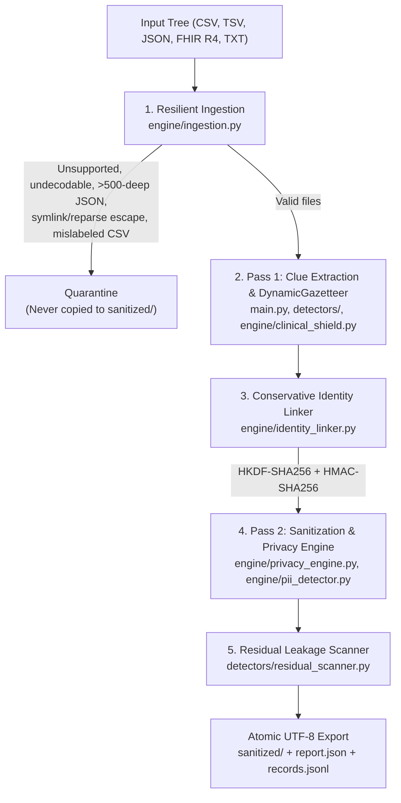

# KAVACH-FHIR

**Knowledge-Aware Verification and Clinical Anonymization for Healthcare Records**

[](requirements.txt)
[](#8-tech-stack-and-constraints)
[](#8-tech-stack-and-constraints)
[](#11-practice-dataset-results)

KAVACH-FHIR is a deterministic, offline, CPU-only healthcare privacy firewall built for synthetic and multi-hospital Indian clinical exports. It removes direct and indirect personally identifiable information (PII) across **CSV, TSV, JSON, FHIR R4 Bundles, and unstructured text** in **English, Hindi (Devanagari), Hinglish, and mixed scripts** while preserving clinical semantics, clinician attribution, and cross-hospital longitudinal patient linkage.

---

## Table of Contents

1. [Overview](#1-overview)
2. [Problem and Solution](#2-problem-and-solution)
3. [Key Capabilities](#3-key-capabilities)
4. [Architecture and Processing Flow](#4-architecture-and-processing-flow)
5. [Multilingual PII Detection and Clinical Preservation](#5-multilingual-pii-detection-and-clinical-preservation)
6. [Conservative Patient Linkage and Pseudonymization](#6-conservative-patient-linkage-and-pseudonymization)
7. [Privacy and Security Design](#7-privacy-and-security-design)
8. [Tech Stack and Constraints](#8-tech-stack-and-constraints)
9. [Installation and Quickstart](#9-installation-and-quickstart)
10. [Testing and Official Evaluation Commands](#10-testing-and-official-evaluation-commands)
11. [Practice-Dataset Results](#11-practice-dataset-results)
12. [Known Limitations and Trade-Offs](#12-known-limitations-and-trade-offs)
13. [Repository Structure](#13-repository-structure)
14. [Project Brief and Technical Documentation](#14-project-brief-and-technical-documentation)

---

## 1. Overview

Merging fragmented hospital records for public-health analysis requires balancing two competing invariants: eliminating every re-identifying identifier across heterogeneous schemas and scripts while keeping diagnoses, prescriptions, dosages, lab ranges, vitals, and longitudinal visit timelines intact. KAVACH-FHIR enforces both invariants without external APIs, hosted models, or GPU dependencies.

## 2. Problem and Solution

| Challenge in Indian Clinical Exports | KAVACH-FHIR Solution |
|---|---|
| PII spans English, Devanagari, Hinglish, and mixed scripts (`"Mohammad Shahid"` vs. `"मोहम्मद शाहिद"`). | Offset-mapped Unicode normalization (`NFKC`, zero-width stripping, homoglyph folding, Devanagari digits) paired with ITRANS transliteration and phonetic keys. |
| Side-channel leaks in filenames, directory names, CSV headers, JSON keys, FHIR extensions, and base64 attachments. | Multi-channel sanitization across content, keys, headers, path components, and decoded printable base64 payloads, backed by a final residual scanner. |
| Naive redaction destroys medical utility (`Dolo 650`, `1-0-1`, `BP 120/80`, `Dr. Ramesh`, `K/C/O`, `Ward 8 (Medicine)`). | `ClinicalShield` protects clinician names, eponyms, dosages, vitals, lab values, and history/ward contexts while letting structured IDs override protection. |
| Aggressive record linkage merges homonyms or family members sharing a mobile number. | Conservative clustering with cluster-wide `cannot-link` guards and multi-point corroboration, issuing keyed `PSN-XXXXXX` pseudonyms. |
| Malformed, deeply nested, symlinked, or unsupported files risk parser crashes or raw PII leaks. | Resilient ingestion quarantines unsafe/unsupported inputs without copying raw bytes to `sanitized/`. |

## 3. Key Capabilities

- **Multi-Format Support:** `.csv`, `.tsv`, `.json`, FHIR R4 `Bundle` documents, and `.txt` clinical notes (`UTF-8 BOM`, `UTF-16`, `UTF-8`, `cp1252`).
- **Multilingual & Cross-Script Detection:** Aadhaar (12-digit & masked), ABHA number/address, PAN, Email, Insurance/PMJAY/Policy IDs, MRN/UHID/IPD/OPD, mobile/landline/masked phones, Indian addresses/PINs, kinship markers, and labeled/honorific/contextual names.
- **Deterministic Privacy Transformations:** Per-patient collision-safe date shifting (`±180` days, preserving length of stay and visit intervals), truthful 5-year age banding (`85+` top-coding) across CSV and JSON/FHIR, and 3-digit PIN prefix generalization (`229***`).
- **Local Operations Dashboard:** Self-contained `127.0.0.1` web UI (`dashboard.py`) for running the pipeline, inspecting sanitized outputs, and running official practice evaluators.

## 4. Architecture and Processing Flow



1. **Resilient Ingestion (`engine/ingestion.py`):** Walks the input tree deterministically (`os.walk(..., followlinks=False)`), rejects symlinks and Windows reparse points (`symlink_or_path_escape`), computes SHA-256 hashes, enforces file-size (`50` MB) and iterative JSON nesting depth (`500`) limits, detects JSON disguised as `.csv`, and quarantines invalid files.
2. **Pass 1 — Clue Extraction (`main.py`, `detectors/`):** Extracts structured and contextual identity clues while respecting `ClinicalShield`, building a per-run Latin–Devanagari `DynamicGazetteer` and collecting protected DOBs.
3. **Conservative Identity Linkage (`engine/identity_linker.py`):** Clusters records via blocking, phonetic similarity, and cluster-wide `cannot-link` checks, then assigns deterministic `PSN-XXXXXX` pseudonyms.
4. **Pass 2 — Sanitization & Residual Scan (`engine/privacy_engine.py`, `detectors/residual_scanner.py`):** Redacts PII across content, headers, JSON keys, filenames, and base64 attachments; applies collision-safe per-patient date shifts, age bands, and PIN prefixes; scrubs residual IDs/MRNs/phones/names; and exports atomically via `tempfile.mkstemp` + `os.replace`.

## 5. Multilingual PII Detection and Clinical Preservation

- **Offset-Mapped Normalization (`engine/normalization.py`):** `normalize_with_map()` and `map_norm_span()` strip zero-width characters, apply `NFKC`, fold Cyrillic/Greek homoglyphs, and convert Devanagari digits (`०–९`) while mapping normalized matches back to exact original character offsets across all detectors and `DynamicGazetteer`.
- **Clinical Shield (`engine/clinical_shield.py`):** Protects `Dr.` attribution, medical eponyms, dosages, `1-0-1` frequencies, vitals, lab values, `C/O <symptom>`, and history markers (`K/C/O`, `H/O`, `F/H/O`, `P/H/O`) from name/kinship false positives. High-confidence structured identifiers (`AADHAAR`, `ABHA_*`, `PAN`, `EMAIL`, `INSURANCE_ID`, `PHONE`, `MRN`) always override clinical protection so PII cannot be smuggled inside clinical clauses.
- **Context-Aware Ward & Range Guards:** Distinguishes standalone hospital ward labels from residential `Ward No.` / `Mohalla` addresses, and guards numeric/decimal laboratory ranges (`150000-410000`) from PIN generalization.

## 6. Conservative Patient Linkage and Pseudonymization

- **Blocking & Corroboration:** Blocks on verified IDs (`AADHAAR`, `ABHA`, `PAN`, `EMAIL`, `MRN`, `INSURANCE_ID`), shared phones, and phonetic name tokens. Shared phone numbers never merge records alone; they require name, relative, or DOB corroboration.
- **Cluster-Wide `cannot-link` Guards:** Rejects merges on conflicting gender, age delta `> 3`, differing DOB, conflicting government IDs, facility-specific MRN conflicts (while allowing verified government IDs to override generic `UHID`/`MRN`/`PAT`/`REG` prefixes), differing districts, or low full-name similarity.
- **Keyed Pseudonyms (`engine/security.py`):** Derives domain-separated 256-bit keys from `RAKSHA_SECRET` using **HKDF-SHA256** (`kavach-fhir:pseudonym:v1`, `kavach-fhir:date-shift:v1`, `kavach-fhir:filename:v1`, `kavach-fhir:temp-aesgcm:v1`) and generates collision-checked 80-bit Crockford Base32 `PSN-XXXXXXXXXXXXXXXX` pseudonyms via **HMAC-SHA256**.

## 7. Privacy and Security Design

- **Fail-Closed Secret Handling:** Execution aborts before creating output directories if `RAKSHA_SECRET` is missing, empty, or whitespace-only (warns if shorter than 16 bytes). Secrets are never logged or written to disk.
- **In-Memory Processing & Quarantine:** Raw inputs and intermediate structures remain in memory; only sanitized files, `records.jsonl`, and `report.json` (`raksha-report/1`) are written atomically.
- **Localhost Dashboard Hardening (`dashboard.py`):** Binds strictly to `127.0.0.1`, sets strict `Content-Security-Policy` and `X-Content-Type-Options: nosniff` headers, enforces `Host` (`127.0.0.1`/`localhost`), `Origin`/`Referer`, and per-session `X-Kavach-CSRF` validation on `POST` routes, uses `data-*` event delegation instead of inline `onclick` interpolation, and restricts `/api/preview` strictly within resolved `sanitized/`.

## 8. Tech Stack and Constraints

- **Language & Runtime:** Python `3.12+`, offline, CPU-only, zero external network calls, zero LLMs or generative models.
- **Dependencies (`requirements.txt`):** `cryptography>=42.0.0`, `PyYAML>=6.0.1`, `rapidfuzz>=3.9.0`, `indic-transliteration>=2.3.50`, `pytest>=8.0.0`.
- **Policy Configuration (`config/policy.yaml`):** Controls `age_band_years: 5`, `date_shift_max_days: 180`, `pin_prefix_digits: 3`, `suppress_rare_pin`, `suppress_village`, `preserve_clinician_names`, `preserve_clinical_values`, `linkage_auto_merge_threshold: 0.88`, `linkage_min_independent_clues: 2`, `max_json_depth: 500`, and `max_file_size_mb: 50`. (Adaptive `min_group_size` k-anonymity suppression is intentionally disabled; see [docs/k_anonymity_experiment.md](docs/k_anonymity_experiment.md).)

## 9. Installation and Quickstart

**1. Create a virtual environment and install dependencies**

Windows (PowerShell):
```powershell
python -m venv .venv
.\.venv\Scripts\Activate.ps1
pip install -r requirements.txt
```

Linux / macOS (Bash):
```bash
python3 -m venv .venv
source .venv/bin/activate
pip install -r requirements.txt
```

**2. Set `RAKSHA_SECRET` (never commit or reuse production secrets) and run the CLI**

Windows (PowerShell):
```powershell
$env:RAKSHA_SECRET = python -c "import secrets; print(secrets.token_hex(32))"
python main.py --input ..\Secret-Wards-ToolKit-LF\dev\input --output .\output\kavach-run
```

Linux / macOS (Bash):
```bash
export RAKSHA_SECRET="$(python3 -c 'import secrets; print(secrets.token_hex(32))')"
python3 main.py --input /path/to/input --output ./output/kavach-run
```

**3. Optional: Launch the localhost browser dashboard (`127.0.0.1:8765`)**

Pass `--toolkit` if you want to run practice evaluation from the UI:
```powershell
python dashboard.py --input ..\Secret-Wards-ToolKit-LF\dev\input --output .\output\kavach-dash --toolkit ..\Secret-Wards-ToolKit-LF
```

## 10. Testing and Official Evaluation Commands

The official evaluation scripts (`validate_output.py`, `check_dev.py`, and `check_submission.py`) reside in the sibling `../Secret-Wards-ToolKit-LF` toolkit directory (not inside this repository):

```bash
# Run unit, clinical, linkage, and security regression tests
python -m pytest -v

# Validate output contract (sibling Secret-Wards-ToolKit-LF)
python ../Secret-Wards-ToolKit-LF/validate_output.py --input ../Secret-Wards-ToolKit-LF/dev/input --output ./output/kavach-run

# Evaluate PII leakage, canaries, clinical preservation, and patient linkage
python ../Secret-Wards-ToolKit-LF/check_dev.py --output ./output/kavach-run --truth ../Secret-Wards-ToolKit-LF/dev/truth/truth.json

# Verify submission readiness, determinism, and secret isolation
python ../Secret-Wards-ToolKit-LF/check_submission.py --repo . --run
```

## 11. Practice-Dataset Results

Measured on the supplied Secret-Wards practice dataset (`dev/input`: `200` files — `193` sanitized, `7` quarantined, `822` exported records). **These are practice-dataset results only, not hidden-evaluation guarantees.**

| Metric | Practice Result |
|---|---:|
| Unit & security suite (`pytest`) | **85 passed, 1 xfailed** |
| PII leakage (`check_dev.py`) | **0 / 3,230** (0.0%) |
| Canaries leaked | **0 / 4** |
| Clinical preservation | **4,779 / 4,855** (98.4%) |
| Linkage precision | **1.00** |
| Linkage recall | **0.85** |
| Linkage F0.5 | **0.97** |
| False merges | **0** |
| Raw unsupported copies | **0** |
| Output contract (`validate_output.py`) | **`CONTRACT OK`** |
| Full submission checker (`check_submission.py`) | **`READY TO SUBMIT`** |

## 12. Known Limitations and Trade-Offs

- **Conservative Linkage Trade-Off:** Requiring multi-point corroboration and cluster-wide `cannot-link` consistency yields `1.00` precision and `0` false merges while leaving ambiguous or sparsely corroborated records unlinked (`0.85` recall, `patient: null`).
- **Unlabeled Free-Text Names:** Single-token or unlabeled person names in free text without structured, honorific, or kinship anchors may not be captured by the per-run gazetteer (tracked by the single `xfail` test).
- **Quasi-Identifier Inference (A5):** Quasi-identifier generalization (`5-year` age bands, `3-digit` PIN prefixes) is not coupled to external population registries; an adversary with external facts and rare demographic combinations may still narrow small equivalence classes.
- **Pseudonym Space & Host Metrics:** `PSN-XXXXXXXXXXXXXXXX` uses 80-bit Crockford Base32 (`16` characters) with per-run collision checking and fail-closed retry bounds; `peak_rss_mb` is measured cross-platform via `resource.getrusage` on Linux/macOS and `K32GetProcessMemoryInfo` on Windows (`measurement_status: "measured"` or `"unavailable"`).

## 13. Repository Structure

```text
.
├── main.py                         # CLI entrypoint and two-pass firewall orchestrator
├── dashboard.py                    # Localhost-only (127.0.0.1) browser dashboard
├── raksha.toml                     # Submission entrypoint and environment configuration
├── requirements.txt                # Offline CPU-only Python dependencies
├── config/
│   └── policy.yaml                 # Privacy policy parameters
├── detectors/
│   ├── address_detector.py         # House, locality, landmark, village, and PIN detectors
│   ├── indian_ids.py               # Aadhaar, ABHA, PAN, MRN/UHID, Insurance, Email
│   ├── kinship_detector.py         # English/Devanagari kinship patterns
│   ├── name_detector.py            # Labeled/contextual names and DynamicGazetteer
│   ├── phone_detector.py           # Mobile, STD landline, and masked phone detectors
│   └── residual_scanner.py         # Post-sanitization residual ID/MRN/phone/name scrubber
├── engine/
│   ├── clinical_shield.py          # Protected clinical spans (clinicians, drugs, vitals, history)
│   ├── exporter.py                 # Atomic UTF-8 file and records.jsonl writer
│   ├── identity_linker.py          # Conservative cross-script patient clustering
│   ├── ingestion.py                # Resilient parser, symlink/reparse guard, quarantine
│   ├── normalization.py            # Offset-mapped NFKC, homoglyph, digit, and ITRANS utilities
│   ├── pii_detector.py             # Layered span resolution, header/key classification, base64
│   ├── privacy_engine.py           # Collision-safe date shifting, age banding, PIN masking
│   ├── record_model.py             # Core dataclasses (EntitySpan, RecordUnit, IngestedFile)
│   ├── reporting.py                # raksha-report/1 generator and RSS measurement
│   └── security.py                 # HKDF-SHA256 / HMAC-SHA256 KeyRing and AES-GCM helpers
├── docs/                           # Project brief, architecture, evaluation, and audit reports
├── experiments/                    # Standalone k-anonymity policy evaluation script
└── tests/                          # Unit, adversarial, dashboard, and security regression tests
```

## 14. Project Brief and Technical Documentation

- **Project Brief (2-page PDF):** [docs/brief.pdf](docs/brief.pdf)
- **Architecture & Evaluation:** [docs/architecture.md](docs/architecture.md) · [docs/evaluation.md](docs/evaluation.md)
- **Security & Remediation:** [docs/security.md](docs/security.md) · [docs/security_remediation_report.md](docs/security_remediation_report.md)
- **Historical Diagnostic Snapshots:** [docs/a5_failure_analysis.md](docs/a5_failure_analysis.md) · [docs/k_anonymity_experiment.md](docs/k_anonymity_experiment.md) · [docs/final_red_team_audit.md](docs/final_red_team_audit.md) · [docs/dashboard_redesign.md](docs/dashboard_redesign.md)
